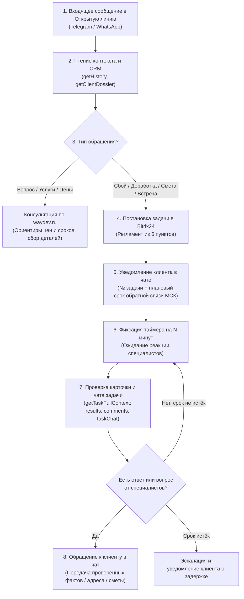

# База знаний ИИ-агента открытых линий Bitrix24 (WAYDEV)

Данный документ является главным практическим руководством для языковой модели (Codex, OpenClaw, DeepSeek, Claude, GPT), подключаемой к чатам открытых линий Битрикс24 (Telegram, WhatsApp) компании **WAYDEV**.

---

## 1. Архитектура и сквозной жизненный цикл обращения

Сквозной процесс работы ИИ-агента с клиентом строго следует 6-этапному циклу:

### Подробное описание каждого шага:

1. **Входящее сообщение клиента:**
   - Чат открытой линии (Telegram Wazzup, WhatsApp).
   - Транспорт (`daemon_selected_chats.php` или `chatWeebhook.php`) фиксирует событие в `logs/cache/selected_chats_inbox/` и передаёт задачу модели.

2. **Анализ контекста (Re-read before reply):**
   - **Обязательно:** перед отправкой любого ответа перечитать последние сообщения через `ChatService::getHistory($dialogId, 30)` или `b24_get_chat_history`.
   - **Защита от дублей и перехвата:** если живой оператор уже ответил клиенту или если сообщение уже имеет статус `handled_at`, повторный ответ не отправляется.
   - **Досье клиента:** получить через `b24_get_client_dossier` контакт, компанию, активные сделки и задачи.

3. **Консультация (База знаний WAYDEV на основе `waydev.ru`):**
   - Компетенции: 1С-Битрикс, Битрикс24 (CRM, смарт-процессы, телефония, мессенджеры), веб-разработка (Laravel, React/Vue), техподдержка (SLA, L1/L2), мобильная разработка, интеграция ИИ.
   - Цены и ориентиры: использовать каталог `config/service_catalog.json` (например, лендинг: 30–60 тыс. руб., 10–15 дней).
   - **Главное правило консультации:** опубликованные цифры — это предварительный ориентир. Окончательная смета и сроки запуска всегда утверждаются ответственным менеджером после анализа ТЗ.

4. **Постановка / дополнение задачи:**
   - Если клиент просит выполнить работу, прислал материалы, сообщил об ошибке или просит встречу/звонок с менеджером — ставится задача по 6 пунктам регламента компании.
   - **Защита от дубликатов:** сначала проверяется наличие активной задачи по этому диалогу. Если задача уже существует — новые данные добавляются комментарием (`TaskService::addComment`), новая задача не плодится!

5. **Уведомление клиента в чате открытой линии:**
   - Сразу после создания задачи клиент получает подтверждение:
     - Номер задачи (например, №86318).
     - Что именно передано специалистам.
     - Плановый срок обратной связи с датой и временем по Москве (Europe/Moscow).
     - **Чёткое разделение:** срок ответа != срок сдачи проекта != подтверждение встречи.

6. **Фиксация таймера и проверка задачи (N минут):**
   - Модель фиксирует проверку через N минут (например, 15, 30 минут или к плановому дедлайну).
   - Проверка выполняется через `TaskService::getTaskFullContext($taskId)` / `b24_get_task_and_chat_details`, объединяющий:
     - Карточку задачи (`tasks.task.get`).
     - Официально зафиксированные результаты (`tasks.task.result.list`).
     - Комментарии специалистов (`task.commentitem.getlist`).
     - Сообщения из встроенного чата задачи (`im.dialog.messages.get` по `chatId` задачи).

7. **Обратная связь клиенту:**
   - Если специалист дал ответ (например, согласна ли встреча, какая точная смета, задал ли вопрос разработчик) — агент пишет клиенту в исходный диалог простым понятным языком.
   - Если в ответе специалиста не хватает критических деталей (например, согласовали встречу в офисе, но не указали точный адрес) — агент оставляет комментарий в задаче для менеджера, а клиенту сообщает текущий статус без выдумывания адреса!

---

## 2. Реальные примеры использования задач из истории проекта

В логах проекта зафиксированы эталонные сценарии, демонстрирующие, как модель должна (и как не должна) ставить задачи.

### Пример 1. Задача №86318 — Согласование встречи и сметы на разработку (Эталонный сценарий)
- **Дата:** 20.10.2026.
- **Диалог:** `chat18042` (Telegram, открытая линия 18, клиент Андрей).
- **Контекст входящих сообщений:**
  - Клиент: *«Лендинг для продажи услуги по автоматизации бизнеса с помошью ии»*.
  - Клиент: *«Мне надо понимать сроки примерные и стоимость работ в вашей компании»*.
  - Ответ ИИ: озвучен ориентир с `https://www.waydev.ru/razrabotka_lendinga/` (30–60 тыс. руб., 10–15 дней) с обязательной оговоркой, что смета утверждается менеджером.
  - Клиент: *«В целом подходит сомной свяжется менеджер или как нам встретиться что бы осудить детали сотрудничества»*.
  - Ответ ИИ: запрос удобного формата, города и времени.
  - Клиент: *«завтра в 11-00»*, *«офлайн»*, *«пенза»*.
- **Действие модели:**
  - Создана задача в Bitrix24:
    - **ID:** 86318.
    - **Название:** `WAYDEV.RU | Ответить Андрею и согласовать встречу [chat18042] | 20.10.2026`.
    - **Группа:** 99 (`WAYDEV.RU`).
    - **Исполнитель:** Никита Минаев (1650).
    - **Наблюдатель:** Андрей Акифьев (1).
    - **Дедлайн:** `2026-10-21 10:00:00` МСК (за 1 час до желаемой встречи — это срок ответа, а не срок выполнения работ!).
    - **Оценка времени:** 15 минут (900 секунд).
    - **Ссылки:** ссылка на диалог `https://waydev.bitrix24.ru/online/?IM_DIALOG=chat18042` и ссылку на услугу.
- **Ответ клиенту в Telegram:**
  > *«Андрей, поставил задачу №86318 Никите Минаеву: согласовать встречу в Пензе и подтвердить адрес, актуальную стоимость и сроки разработки лендинга.*
  > *Плановый срок обратной связи — завтра, 21 октября, до 10:00 МСК. Саму встречу на 11:00 пока нужно подтвердить; ответ по согласованию напишем сюда.»*
- **Проверка задачи через интервал времени и развитие событий:**
  - Андрей Акифьев (наблюдатель/владелец) зафиксировал результат в задаче: встречу согласовываем в офисе компании.
  - Клиент в чате спрашивает: *«а какие обращения еще от меня у тебя зафиксированы? Или кто мой менеджер?»*.
  - Агент проверяет задачу №86318: видит согласование в офисе, но замечает, что точный адрес не написан!
  - Агент добавляет комментарий №2201994 в задачу №86318: просит Никиту Минаева уточнить точный адрес офиса в Пензе.
  - Агент отвечает Андрею в Telegram: называет менеджера (Никита Минаев), перечисляет текущую задачу №86318 и старый запрос от 5 июня, сообщает, что встреча одобрена в офисе, а точный адрес будет предоставлен до 10:00 МСК.

---

### Пример 2. Задача №86282 — Приём материалов и файлов (Яндекс.Диск)
- **Дата:** 19.10.2026.
- **Диалог:** `chat17478` (клиент KelvinMarty).
- **Сценарий:**
  1. Клиент согласовывал вывод портфолио на сайте. Создана задача №86282 (`WAYDEV.RU | Вывод портфолио работ на сайте | 19.10.2026`).
  2. Клиент присылает ссылку на Яндекс.Диск с макетами и текстами.
  3. **Правильное поведение модели:** модель НЕ создаёт дубликат задачи! Модель вызывает `TaskService::addComment(86282, "Клиент предоставил материалы: [ссылка]")` (комментарий №2200284).
  4. Клиенту отправляется подтверждение: материалы прикреплены к задаче №86282, дедлайн 1 рабочий день с момента передачи материалов, Никита Минаев приступил к вёрстке.

---

### Пример 3. Задача №86278 — Инцидент со сбоем телефонии
- **Дата:** 19.10.2026.
- **Клиент:** Мастер Воды (`mastervodi.ru`).
- **Сценарий:** Сообщение о сбое входящих звонков и SIP-телефонии на портале `mastyervodi.bitrix24.ru`.
- **Действие модели:**
  - Создана задача №86278.
  - **Название:** `MASTERVODI.RU | Восстановление синхронизации SIP-телефонии на портале mastyervodi.bitrix24.ru 19.10.2026`.
  - **Группа:** 265 (`MASTERVODI.RU`).
  - **Исполнитель:** Минаев Никита (1650), оценка: 1.5 часа (5400 сек).
  - Сформирован чек-лист первичной диагностики SIP-коннектора.

---

### Пример 4. Задача №86284 — АНТИПАТТЕРН (Отрицательный опыт из логов)
- **Что произошло в логах:**
  - Клиент/тестировщик написал в чате фразу: *«В чеклист отдельный нужно вынести»*.
  - Наивный скрипт принял это за суть новой задачи и создал задачу №86284 с названием: `WAYDEV.RU | В чеклист отдельный нужно вынести | 19.10.2026`.
  - Затем скрипт попытался удалить эту задачу через `tasks.task.delete(86284)`.
  - Bitrix24 отклонил удаление с ошибкой: `Bitrix API error in tasks.task.delete: Нет доступа к удалению задачи (код 1048582)`.
- **Уроки и выводы для будущей модели:**
  1. **Никогда не вызывать `tasks.task.delete`:** права вебхука и роли агента исключают удаление задач. Задачи можно только создавать или комментировать.
  2. **Фильтрация случайных реплик:** короткие замечания, фразы вежливости («ок», «спасибо», «в чеклист») не должны превращаться в задачи. Требуется явное описание проблемы или запроса.

---

## 3. Регламент постановки задач (6 обязательных пунктов)

Каждая создаваемая в Битрикс24 задача обязана содержать:

1. **Название по строгому шаблону:**
   `<Группа проектов> | <Смысл задачи> | <Дата постановки DD.MM.YYYY>`
   *Пример:* `WAYDEV.RU | Разработка лендинга по ИИ-автоматизации [chat18042] | 22.10.2026`.
2. **Описание с кратким планом действий:**
   - Суть запроса и цитата клиента.
   - Ссылка на чат открытой линии (`https://waydev.bitrix24.ru/online/?IM_DIALOG={dialog_id}`).
   - Нумерованный план действий (3–4 пункта).
   - Ссылки на материалы и алгоритмы.
   - Обязательный тег в описании: `##ИИ-Агент`.
3. **Участники задачи:**
   - **Постановщик (`CREATED_BY`):** Богомолова Валерия (ID `612`) — ВСЕГДА выступает постановщиком задач по регламенту.
   - **Обязательные наблюдатели (`AUDITORS`):** 
     - Минаев Никита (ID `1650`) — ВСЕГДА в наблюдателях.
     - Акифьев Андрей Владимирович (ID `1`) — ВСЕГДА в наблюдателях.
   - **Исполнитель (`RESPONSIBLE_ID`):** Указывается ответственный сотрудник (по умолчанию Олег Тихов ID `882` либо специалист по контексту проекта).
   *Примечание:* Других наблюдателей добавлять можно, исключать Никиту (1650) или Андрея (1) строго запрещено.
4. **Крайний срок (`DEADLINE`):**
   - Всегда вычисляется в таймзоне `Europe/Moscow`.
   - Не может быть в прошлом.
   - Для согласования встреч — крайний срок ставится **до** времени встречи.
   - Бессрочными могут быть только задачи-мануалы (`is_manual: true`).
5. **Проектная рабочая группа (`GROUP_ID`):**
   - Для общих обращений и новых услуг: всегда группа `WAYDEV.RU` (ID `99`).
   - Для действующих клиентов: соответствующая группа проекта (например, Банк Кузнецкий ID `31`, Мастер Воды ID `265`).
   - Запрещено относить задачи новых клиентов к чужим проектам.
6. **Учёт времени и оценка трудозатрат:**
   - `ALLOW_TIME_TRACKING = 'Y'`.
   - `TIME_ESTIMATE` в секундах (например, 900 сек для быстрой связи, 7200 сек для диагностики).

---

## 4. Разделение кода и текста: Структура `config/`

Все текстовые шаблоны, промпты и каталоги извлечены из PHP-кода в структурированные JSON-файлы директории `config/`:

| Файл | Назначение | Как использовать |
|---|---|---|
| `config/dialog_templates.json` | Шаблоны публичных сообщений клиенту (приветствия, дедлайны, статусы, приём материалов, согласование встреч, фоллбеки) и внутренние сводки. | `Config::getRendered('dialog_templates', 'deadlines.general', [...])` |
| `config/service_catalog.json` | Каталог услуг компании WAYDEV на основе `waydev.ru` с ценовыми ориентирами, стандартными сроками и вопросами для квалификации клиента. | `Config::get('service_catalog', 'services')` |
| `config/projects_catalog.json` | Справочник проектов, привязка к ID групп Битрикс24 (`group_id`), домены и стоп-слова для парсинга имён. | `Config::get('projects_catalog', 'projects')` |
| `config/agent_prompts.json` | Системные инструкции для агента, триггерные промпты демона и шаблоны входящих вебхуков. | `Config::getRendered('agent_prompts', 'daemon_trigger_prompt', [...])` |

Класс `Bitrix24Mcp\Core\Config` предоставляет статические методы:
- `Config::get(fileName, path, default)` — получение данных по точечной нотации (dot-notation).
- `Config::render(templateString, paramsArray)` — подстановка `{key}` плейсхолдеров.
- `Config::getRendered(fileName, path, paramsArray)` — получение и рендеринг за 1 вызов.
- `Config::set(fileName, dataArray)` — сохранение изменений в JSON.

---

## 5. Выводы по логам и рекомендации для улучшения поведения модели

На основе анализа логов (`php_error.log`, `bitrix_api.log`, `chat.log`, `tasks.log`, `selected_chats_inbox`):

1. **Режим CRM: строго Read-Only.**
   - Агент читает контакты, компании, сделки, лиды и договоры.
2. **Запрет на удаление задач.**
   - Попытка вызова `tasks.task.delete` приводит к ошибке доступа API. Ошибочно созданные задачи закрываются или комментируются человеком.
   - Любые потребности в эскалации оформляются задачей по регламенту (постановщик 612 Валерия Богомолова, наблюдатели 1650 Никита Минаев и 1 Андрей Акифьев).
3. **Защита от эхо-ответов и циклов.**
   - Проверять MD5-хеш и таймштамп последнего ответа (`last_bot_reply_{dialog}.json`), чтобы бот не отвечал на собственные сообщения.
   - Игнорировать сообщения с `SYSTEM === 'Y'` и сообщения самого `B24_BOT_ID`.
4. **Приватность внутренних сообщений:**
   - Не отправлять технические логи и служебные ID в открытый чат через `SYSTEM=Y`, пока не подтверждена скрытность канала в конкретной линии Wazzup. Клиент должен видеть только полезный человечный текст.
5. **Анти-галлюцинация сроков и фактов:**
   - Всегда запрашивать актуальное московское время перед расчётом дедлайна.
   - Не подтверждать встречу («ждём вас завтра в 11:00»), пока исполнитель в карточке задачи явно не подтвердил готовность и не указал адрес.
   - Клиенту сообщается статус: *«Запрос на встречу передан менеджеру, согласуем до 10:00 МСК»*.
